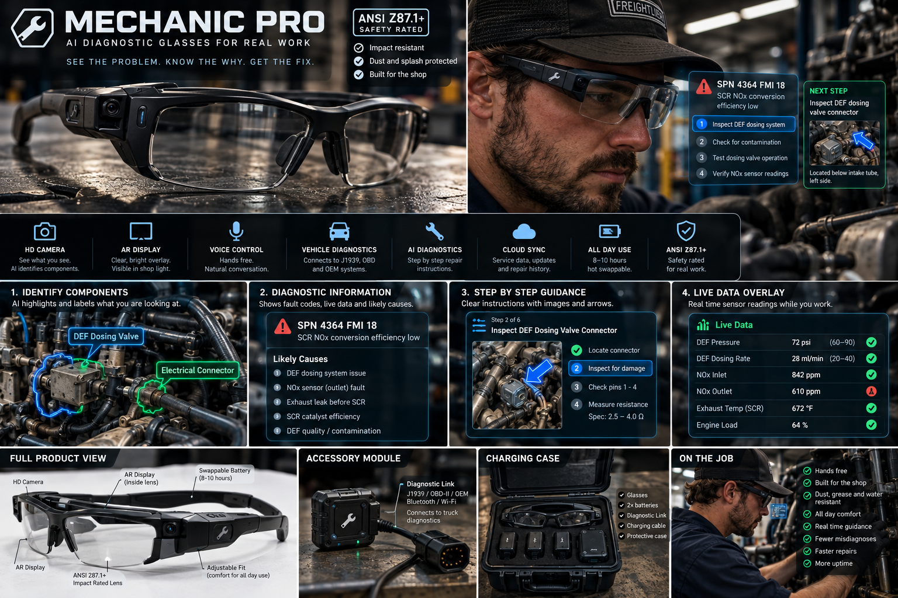
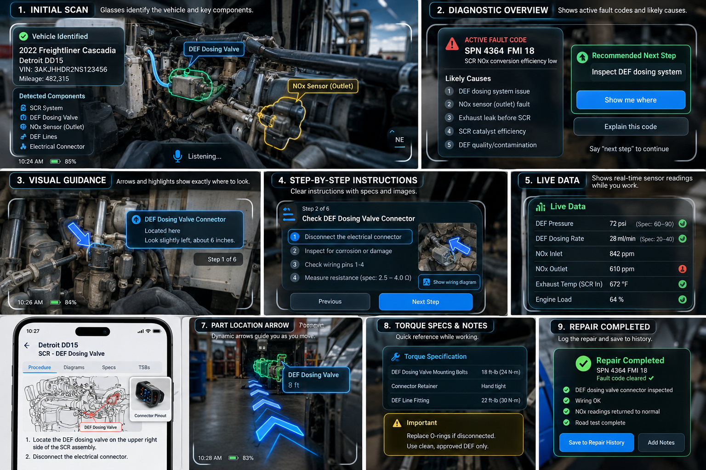

# TraceView

AR safety glasses for diesel and heavy-truck techs. The glasses lay the vehicle's wiring and parts over the real truck, and voice filters what you see ("show me the starter system").

This repo holds the working web prototype, the product design doc, and the concept mockups.

## Live demo (GitHub Pages)

| Page | What it is |
| --- | --- |
| [`/` (index.html)](index.html) | **Live camera + WebXR AR build.** Your phone's camera acts as the glasses camera. Same overlays, panels and voice-style commands as the 3D demo. |
| [`/demo-3d/`](demo-3d/) | The earlier build on a 3D Cascadia model you can orbit, with the developer tech mode for part placement. |

### Using the live build

1. Open the Pages link on your phone (HTTPS is required for the camera).
2. **AR tracking (Android Chrome with ARCore):** tap **Start AR**. Point at the floor beside the truck.
   - Tap the ground under the **front tire's outer edge**.
   - Then tap under the **first drive tire**.
   - The overlay locks to the truck using the measured wheelbase and stays anchored as you walk. **Re-align** redoes the two taps.
3. **Camera mode (iPhone / any browser):** tap **Live camera**. Line the steer hub and first drive hub up with the two tap targets. The overlay is fixed to the screen, so hold the phone steady.
4. Use the chips or the command bar: `show me the starter system`, `isolate the starter relay`, `exploded view of the starter`, `start job`, `next step`, `show me where`, `clear`.

Nothing is recorded or captured. The camera feed stays on the device.

**Limits:** Safari on iPhone has no WebXR AR yet, so it uses camera mode. AR mode is one full-screen view, not the two-lens layout. Part positions are **estimates** for a 2026 Cascadia 126 day cab. Use the developer tech mode in `/demo-3d/` to save real measurements.

## Repo layout

```
index.html                 live camera + WebXR AR build (single file)
demo-3d/                   3D-model build (three.js r160 + CC BY Cascadia model)
docs/
  TraceView-Design-Concept.md   product design doc
  TraceView-Design-Concept.pdf  same doc as PDF
images/
  mockup-product-sheet.png      "Mechanic Pro" product concept sheet
  mockup-workflow-hud.png       app + glasses HUD workflow concept
```

## Concept mockups




## Data and credits

- Wiring and torque data are tagged by source in the app: public DTNA service bulletins (static.nhtsa.gov), Delco Remy instruction sheets, general shop practice, and demo/unverified entries. **These are not OEM schematics. Always confirm against the OEM procedure and a meter.**
- 3D model: "FREIGHTLINER CASCADIA 2020" (https://sketchfab.com/3d-models/freightliner-cascadia-2020-2dd8eb87823c4eacabfb9d145eff5450) by liebherr996litronic (https://sketchfab.com/liebherr996litronic), licensed under CC-BY-4.0 (http://creativecommons.org/licenses/by/4.0/).
- three.js (MIT), bundled in `demo-3d/lib/`.
