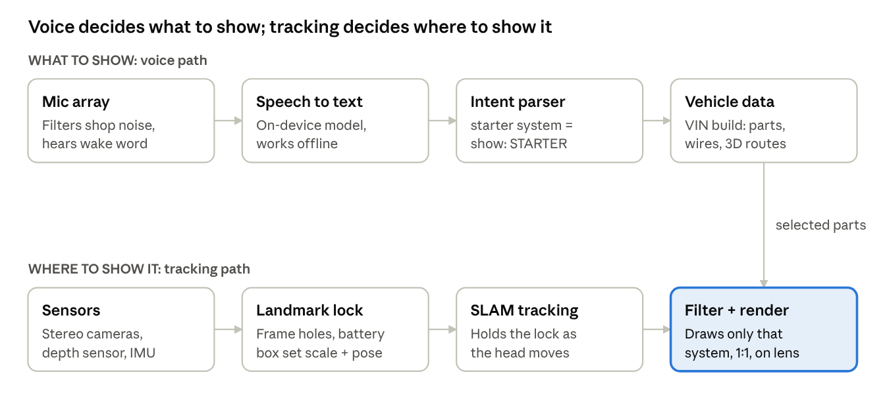

# AR Mechanic Safety Glasses — Product Design Concept

Oct 29, 2026 · @Drew

## Concept summary

Working name: **TraceView**. Z87.1-rated safety glasses that lay the vehicle's wiring and components over what the tech is looking at, at 1:1 scale, and filter by voice: say "show me the starter system" and only the starter circuit lights up on the real truck.

**The problem.** A wiring schematic is a logical drawing, not a physical map. The tech reads it on a laptop or a printout, then has to work out where connector C-104 actually sits on the chassis. That back-and-forth costs time on every electrical job, and it is worse on heavy trucks where harnesses run the full frame length and options vary by build.

**The fix.** Pull the schematic for that exact VIN, place it in 3D on the vehicle, and show only the system the tech asks for. Hands stay on the tools; eyes stay on the job.

**Who it's for.**

- Heavy-duty and diesel techs at dealerships (Freightliner, Western Star, etc.), where VIN-specific build data already exists

- Fleet shops and mobile service techs who see many configurations

- Students and new techs, who gain the most from seeing where a circuit physically runs

**First target market:** OEM dealer service departments. They have the build data, the warranty-labor pressure, and the budget for tooling.

## User experience

Everything runs on a wake word plus short phrases, so a tech in gloves never has to touch the glasses.

**Walkthrough: a no-crank complaint on a Freightliner Cascadia**

1.  Tech puts on the glasses and says "TraceView, load truck." The camera reads the VIN plate (or the tech reads it out), and the build-specific wiring loads.

2.  Tech looks at the frame rail and cab. The glasses lock onto known anchor points (frame rail holes, battery box, starter mounting), and a green "Locked" icon shows.

3.  "Show me the starter system." Everything else fades. Battery cables, the starter, the starter relay, the ignition switch feed and the grounds glow in place, routed where they really run.

4.  "Isolate the relay." The view zooms to the starter relay. Pins are labeled with circuit numbers and wire colors, and expected voltages appear beside each pin.

5.  "Where's ground G-3?" An arrow points to the ground stud, even if it's behind the tech.

6.  "Show me voltage drop test." The OEM test steps overlay with meter lead positions marked on the actual terminals.

7.  "Clear." The display goes fully transparent.

**Core voice commands**

| Command                                       | What it does                                                                                        |
|-----------------------------------------------|-----------------------------------------------------------------------------------------------------|
| "Show me the \[system\]"                      | Show only that system: starter, charging, lighting, ABS, aftertreatment, J1939 datalink, HVAC, etc. |
| "Add \[system\]" / "Hide \[system\]"          | Stack or remove systems                                                                             |
| "Isolate \[component\]"                       | Zoom to one part with pin-out                                                                       |
| "Where is \[component / connector / ground\]" | Arrow guidance to the location                                                                      |
| "Trace circuit \[number or color\]"           | Follow one wire end to end                                                                          |
| "Show voltages" / "Show pin-out"              | Toggle spec values on pins                                                                          |
| "Show \[procedure\] test"                     | Overlay OEM test steps                                                                              |
| "Ghost mode" / "Solid mode"                   | Dim or bold the overlay                                                                             |
| "Snapshot"                                    | Save an image to the repair order                                                                   |
| "Clear"                                       | Hide all overlays immediately                                                                       |

**HUD layout rules**

- The center of vision stays clear except for the selected system. Status (lock quality, battery, system name) sits in the top corner.

- Each system has one fixed color so techs learn them: starter red, charging orange, grounds black-outlined, datalink purple.

- Wire colors are shown as labels, not as the line color, so the system color stays readable.

- High-voltage and hot-surface zones always show as a hatched warning, even when filtered out.

## Hardware design

The glasses are a safety product first: if the electronics die, they must still be a fully rated pair of Z87.1+ safety glasses.

| Subsystem     | Spec target                                                                                                              | Why                                                           |
|---------------|--------------------------------------------------------------------------------------------------------------------------|---------------------------------------------------------------|
| Lens / shield | Polycarbonate, ANSI Z87.1+ high-impact, anti-fog + anti-scratch; display waveguide sits behind the impact lens           | Impact rating can't depend on the display layer               |
| Display       | Binocular waveguide, ~40–50° field of view, 1500+ nits                                                                   | Must read in sunlit shop bays and under lifts                 |
| Cameras       | 2 world-facing (stereo) + 1 high-res RGB for VIN/label reading                                                           | Tracking, depth, and reading part numbers                     |
| Depth         | Small time-of-flight sensor                                                                                              | Measures distance to the vehicle for true 1:1 scale           |
| Motion        | 6-axis IMU                                                                                                               | Keeps overlays steady when the head moves                     |
| Microphones   | 3–4 mic beamforming array                                                                                                | Picks the tech's voice out of impact-gun and compressor noise |
| Audio         | Bone-conduction or open-ear speakers                                                                                     | Feedback without blocking shop sounds                         |
| Compute       | On-glasses low-power chip for tracking + display; heavy work on a belt or phone-sized compute pack over a cable or Wi-Fi | Keeps frame weight and heat down                              |
| Battery       | Swappable rear battery on the strap, 4+ hours; hot-swap from the compute pack                                            | Lasts a full job; balances weight                             |
| Weight        | Under ~120 g on the face                                                                                                 | Wearable for a full shift                                     |
| Fit           | Over-the-ear arms + optional rubber strap; works under a hard hat or welding hood flip-up                                | Shop reality                                                  |
| Durability    | IP54 or better, drop rated to 1.5 m onto concrete, chemical-resistant to brake clean and diesel                          | Shop reality                                                  |
| Prescription  | Magnetic clip-in Rx insert                                                                                               | Many techs wear glasses                                       |

**Non-negotiable safety requirements**

- Meets ANSI Z87.1 high-impact (Z87+) with all electronics installed. Side shields included.

- No sealed battery cells near the eyes; battery sits at the back of the head.

- Display fails transparent. A power loss leaves clear lenses, never a dark or frozen image.

- Physical kill button on the arm that blanks the display instantly, in case voice fails.

## Software architecture

Two paths run in parallel and meet at the renderer: the voice path picks *what* to draw, and the tracking path works out *where* to draw it.

software pipeline · voice path + tracking path

The filter step is a simple lookup once the data is structured right. Every part and wire in the vehicle model carries a list of systems it belongs to, so "show me the starter system" just means "draw everything tagged STARTER, fade the rest."

**Vehicle data model (one per VIN build)**

| Object         | Key fields                                                                           |
|----------------|--------------------------------------------------------------------------------------|
| Component      | ID, name, part number, systems\[\], 3D position on the vehicle, connector list       |
| Connector      | ID (e.g. C-104), pin count, pin-out, face image for snapping                         |
| Wire / circuit | Circuit number, color, gauge, from-pin, to-pin, systems\[\], 3D route points         |
| Ground point   | ID (e.g. G-3), location, circuits served                                             |
| Landmark       | Rigid feature used for locking (frame hole pattern, battery box corner), 3D position |
| Test procedure | Steps, meter lead points, expected values                                            |

**Suggested tech stack:** Unity with AR Foundation or OpenXR for the headset app, an on-device speech model (Whisper-class or the headset's built-in voice engine), and the vehicle model stored as JSON or a small local database so it works with no shop Wi-Fi.

## Companion app and vehicle package

A phone app, **TraceView Link**, handles VIN scanning and keeps the schematic library. The glasses only ever hold one small .json package for the vehicle being worked on. [Companion app prototype](https://claude.ai/artifact/2bibec4mSAbRCS3R2A8QqW)

**Why split it this way:** phones already have a good camera, storage, and cell signal for downloads. That keeps the glasses lighter, cheaper and cooler, and a stolen or lost pair holds one truck's data, not the whole library.

**The hand-off**

1.  The tech scans the VIN plate or door label with the phone camera (on-device text recognition), or types it.

2.  The app checks the VIN's check digit (position 9) to catch misreads like 0/O or 8/B before anything loads.

3.  The VIN is decoded (make, model year, plant, model line) and matched to a build in the phone's schematic library. Builds are downloaded ahead of time so it works in a shop with no Wi-Fi.

4.  The app builds one .json package with only that vehicle's data and signs it with a SHA-256 checksum.

5.  The package goes to the glasses over Bluetooth Low Energy in chunks. The glasses write it to a staging area and check the checksum.

6.  If the glasses already hold a different VIN, the phone first asks: **override with the new vehicle, or keep the current one?** The old package is erased only after the new one passes its checksum, so a failed transfer never leaves the tech with nothing.

7.  Same VIN scanned again: the phone offers a re-send (useful after a library update).

**Package format (traceview.vehicle-package/1)**

| Field            | What it holds                                                                                     |
|------------------|---------------------------------------------------------------------------------------------------|
| schema, vin      | Format version and the vehicle's VIN                                                              |
| vehicle          | Make, model, model year, plant, cab, build ID                                                     |
| source           | Library name and version, data origin and license                                                 |
| coordinate_frame | Units (mm) and the origin point on the frame rail that all positions use                          |
| landmarks        | Rigid points the glasses lock onto (rail end, battery box corner, starter flange)                 |
| systems          | Each system's name, HUD color and voice aliases                                                   |
| components       | ID, name, systems, 3D position, size, pin-out with expected values, voice aliases                 |
| circuits         | Circuit number, gauge, color, from/to, systems, expected value, 3D route points, route confidence |
| tests            | Test procedures with meter lead positions and specs                                               |
| checksum         | SHA-256 of everything above, checked by the glasses                                               |

In the demo a full Cascadia package is about 17 KB, so even a real build with hundreds of circuits should transfer in seconds over BLE.

**Open questions**

- Should the glasses keep the last vehicle after power-off (current design: yes, until a new VIN overrides it)?

- Does a dealer want packages to expire, or wipe at the end of a repair order, for data-license reasons?

- Should the phone also pull live fault codes (J1939 adapter) and send "show me the system for this code" to the glasses?

## Scale and alignment

True 1:1 scale is the hardest part of this product, and the part that makes it worth buying. The plan is to lock to the truck in three layers, from coarse to fine.

1.  **Know the exact truck.** The VIN decodes to the build: cab, engine, frame length, option codes. That picks the right 3D harness model, so a day-cab and a sleeper aren't drawn the same.

2.  **Find fixed reference points.** The software knows where rigid landmarks sit on that build: frame rail bolt-hole patterns, battery box, starter flange, cab mounts, axle centerline. Computer vision spots them, and the depth sensor measures their distance. Three landmarks are enough to fix position, rotation and scale.

3.  **Hold the lock while moving.** Visual-inertial tracking (SLAM: camera + IMU) keeps the overlay pinned as the tech walks around or ducks under the frame. It re-checks landmarks constantly and corrects drift.

**Fallback when vision can't lock** (dirty frame, poor light, aftermarket body): the tech sticks 2–3 reusable printed markers on known points (for example, front frame rail end and battery box corner) and says "lock markers."

**Accuracy targets**

| Zone                   | Target                               | Good enough for              |
|------------------------|--------------------------------------|------------------------------|
| Engine bay / under-cab | ± 1 cm                               | Finding a connector by sight |
| Full frame length      | ± 3 cm                               | Following a harness route    |
| Pin-level zoom         | Snaps to the detected connector face | Reading pin numbers          |

**Honest limit:** harnesses are flexible and get re-routed in the field. The glasses show where the wire *should* run per the build data. The UI says so (a dashed line where the route is inferred, solid where the camera has confirmed the harness).

## Data sources and licensing

The glasses are only as good as the wiring data, and that data belongs to the OEMs and service-info companies. A licensing partnership is the business's biggest early dependency.

| Source                                                                    | What it gives                                                                | Path to access                                |
|---------------------------------------------------------------------------|------------------------------------------------------------------------------|-----------------------------------------------|
| OEM service info (e.g. DTNA's wiring tools for Freightliner/Western Star) | VIN-exact schematics, connector views, component locations                   | OEM partnership; pilot through a dealer       |
| Aftermarket service info (Mitchell 1, ALLDATA, Identifix, etc.)           | Multi-brand schematics                                                       | Data-licensing deal                           |
| Diagnostic link (J1939 / OBD via a Bluetooth adapter)                     | Live fault codes and parameters, so "show me the system for this code" works | Open standards; adapters exist                |
| OEM 3D CAD of harness routing                                             | Physical routes for 1:1 overlay                                              | Hardest to get; needed only for exact routing |
| Self-built scans                                                          | Fallback: map a truck once with the glasses, then reuse it for that model    | Owned data; slow to build                     |

**Key points**

- Schematics are copyrighted. The product can't scrape or redistribute them without a license.

- Most schematics are 2D logical drawings. Turning them into 3D physical routes needs either OEM CAD or a mapping step, and this is a real engineering cost.

- Strategy: start with one OEM and two or three truck models, so the data problem is small enough to solve.

This section is not legal advice. Talk with an IP attorney before any data deal or a patent filing. A provisional patent filing early on is a common, low-cost way to protect the idea while it is pitched.

## Shop-floor safety and risks

The biggest risk is a tech trusting the overlay over the real truck. The design has to keep the tech's own eyes and meter as the final word.

| Risk                                                        | Mitigation                                                                                                 |
|-------------------------------------------------------------|------------------------------------------------------------------------------------------------------------|
| Overlay hides a real hazard (moving fan, hot exhaust, belt) | Auto-dim overlays when the engine is running; hazard zones always shown; peripheral vision kept clear      |
| Wrong data for a modified truck                             | Show the build date and data source on screen; dashed "inferred" routes; a "report mismatch" voice command |
| Misalignment points to the wrong wire                       | Lock-quality indicator; overlays blur out when lock is poor rather than show a confident wrong spot        |
| Voice fails in noise                                        | Beamforming mics, push-to-talk button on the arm, physical kill button                                     |
| Distraction / eye strain                                    | Auto-hide after idle; brightness follows ambient light; one system at a time by default                    |
| Work near high-voltage (EV/hybrid trucks)                   | Orange HV zones always visible; a reminder to follow lockout and PPE procedure before HV work              |
| Battery heat or failure                                     | Battery at the back of the head, thermal cutoff, certified cells                                           |
| Privacy (cameras in a shop)                                 | Recording light, no video stored unless the tech says "snapshot"                                           |

The glasses never replace a meter reading or the OEM procedure. They show the tech where to look and what the spec should be.

## Build roadmap

Prove the software on hardware that already exists before spending on custom glasses. Custom hardware is the last step, not the first.

| Phase                 | What gets built                                                                                          | Gate to move on                                                          | Rough cost (approximate)                           |
|-----------------------|----------------------------------------------------------------------------------------------------------|--------------------------------------------------------------------------|----------------------------------------------------|
| 0\. Concept prototype | Browser HUD demo with voice-style filtering on one truck (the companion prototype to this doc)           | Techs and instructors say "I'd use that"                                 | Near \$0                                           |
| 1\. Headset app       | Unity app on an existing AR headset; one truck model hand-mapped; real voice commands; marker-based lock | Finds a named connector faster than a tech with a laptop schematic       | \$5k–\$30k (headset + dev time)                    |
| 2\. Shop pilot        | Markerless lock, J1939 fault-code link, 2–3 models, one dealer or school shop                            | Measured time saved per electrical repair order; one data partner signed | \$100k–\$500k (small team, data deal, pilot units) |
| 3\. Custom glasses    | Z87.1+ frame with waveguide, compute pack, certification testing, built with a contract manufacturer     | Certified safety rating; unit cost a dealer will pay                     | \$2M+ (engineering, tooling, certification)        |

**Next concrete steps**

- [ ] Show the prototype to UTI instructors and a few working techs; write down what they'd change

- [ ] Pick the first truck model (a Cascadia is the obvious choice) and the first three systems: starter, charging, lighting

- [ ] Look into a provisional patent with an IP attorney

- [ ] Learn the basics of Unity + AR Foundation, or find a developer partner

- [ ] Ask DTNA's training side whether they would back a school pilot

Cost figures are rough estimates from general industry knowledge, not quotes.
